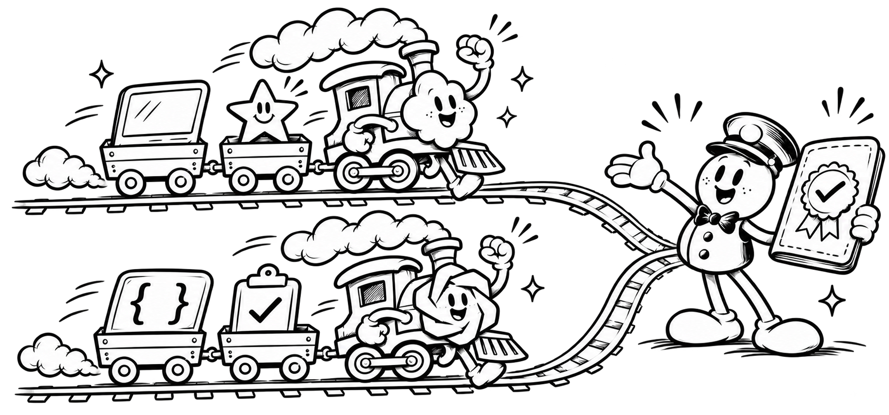

# FullChico Harness: conceito e componentes

O FullChico é um **plugin de orquestração por projeto** para Claude Code e Codex. Ele combina
trilhos de execução, guardrails, ferramentas, memória e validações para que uma demanda só seja
declarada entregue quando chegar ao destino com as evidências exigidas.

## A metáfora do trem

| Elemento | No projeto |
|---|---|
| Estação de entrada | Entrevista, requisitos, plano e portões que liberam a escrita. |
| Locomotiva | O agente que conduz uma tarefa: Claude ou Codex, com modelo configurado para o papel. |
| Vagões | Tickets e habilidades anexadas à tarefa. Cada vagão leva seu trabalho e suas evidências. |
| Trilhos | Dependências entre tickets e guardrails que mantêm a execução dentro do fluxo. |
| Cidades | Regras e portões próprios do projeto, inclusive validações no meio do caminho. |
| Passaporte | Lista de portões exigidos para aquela demanda ou ticket e seus carimbos. |
| Fiscal | Revisor independente: quem executou não aprova o próprio trabalho. |
| Destino | Entrega validada. Um portão reprovado devolve a tarefa para correção e nova revisão. |

As tarefas independentes podem seguir em paralelo. Uma tela pode exigir acessibilidade; uma API,
testes de contrato. O passaporte de uma não carrega automaticamente os carimbos da outra. O
registro `.claude/trilho.json` define os portões de `inicio`, `meio` e `fim`.

Na ilustração de exemplo, o mascote do Claude conduz a entrevista e o vagão de execução; o
mascote do Codex identifica a revisão independente. A configuração real permite escolher os
modelos para cada papel antes de executar.

## Core

- **`tr`:** entrevista (`grill-me`), planejamento, grafo de tickets, portões, passaportes,
  assinaturas por hook, validadores e configuração de modelos para planejamento, execução,
  revisão e apoio.
- **`memoria`:** mapa do código, notas conferidas contra arquivos versionados e busca por grafo
  local compartilhada pelas duas CLIs. O índice gerado fica fora dos arquivos versionados.
- **Instalador:** configura Claude, Codex ou ambos no projeto; ambos é o padrão. Inicia Git local
  quando necessário, sem exigir remoto, push ou PR.

O runner `modelos executar` inicia um papel por vez e pode trocar para o modelo de apoio quando
a CLI retorna erro de limite. O subagente orquestrador usa os tickets e o grafo para coordenar
executores e fiscais independentes. Após a confirmação do plano no `grill-me`, ele resolve
decisões técnicas dentro do escopo e corrige reprovações sem aprovações intermediárias.
Cada portão final permite três reprovações automáticas por padrão; o projeto pode ajustar
`tentativas` e `aprovacao` em `.claude/trilho.json`. A reprovação seguinte ao limite pede
intervenção. Aprovação humana explícita, quando configurada, assina o estado já validado.

## Ferramentas integradas

| Ferramenta | Relação com o harness |
|---|---|
| Skills de Matt Pocock | Fornecem técnicas de entrevista, modelagem e implementação. O fluxo `grill-me` é adaptado e incluído no plugin. |
| Ponytail | Orienta pequenas mudanças e revisões. |
| Graphify | Motor AST opcional para enriquecer a busca da memória; sua skill acompanha o pacote. |
| rtk | Hook opcional que reduz a saída de comandos quando disponível. |
| Git | Base local para relacionar código, memória e carimbos; o instalador faz `git init` se faltar. |

O projeto pode ligar outras skills e comandos aos portões. Segurança, acessibilidade, lint,
testes, remoto e publicação são exemplos de exigências específicas do projeto, não obrigações
globais do harness.
